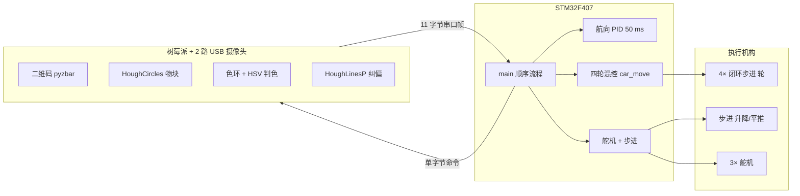
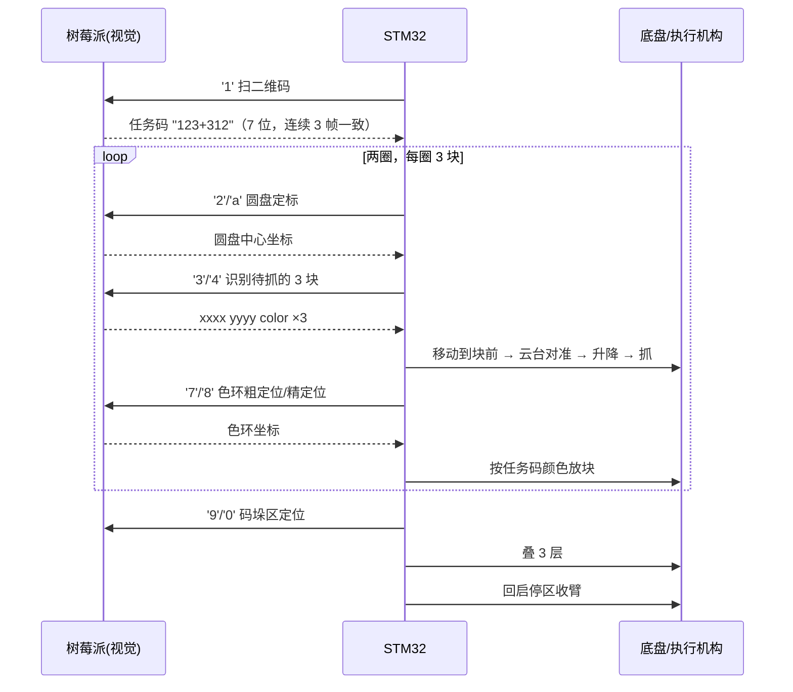

# 智能物流搬运机器人 · Logistics Robot

> STM32F407 + 4 轮底盘 + 5 自由度执行机构（3 舵机 + 2 闭环步进），
> 树莓派跑 OpenCV 做二维码/色环/物块识别，CAN 总线控电机、串口帧控视觉 ——
> 从二维码任务码到抓取、按色码放、码垛的一条完整自动流程。




---

## 目录

- [1. 项目简介](#1-项目简介)
- [2. 任务流程](#2-任务流程)
- [3. 系统组成](#3-系统组成)
- [4. 固件设计](#4-固件设计)
- [5. 视觉算法](#5-视觉算法)
- [6. 通信协议](#6-通信协议)
- [7. 仓库结构](#7-仓库结构)
- [8. 编译与运行](#8-编译与运行)
- [9. 现场标定与调参](#9-现场标定与调参)
- [10. 开源整理说明与已知问题](#10-开源整理说明与已知问题)
- [11. 致谢与许可证](#11-致谢与许可证)

## 1. 项目简介

这是一台参加智能物流搬运类竞赛的小车（省赛版 2025-04、国赛版 2025-08）。任务可以概括成一句话：**扫一个二维码拿到任务码，按任务码的颜色顺序把物块从圆盘搬到地面的色环上，再叠一个三层垛**。

整车技术选择：

| 维度 | 选择 | 理由 |
| --- | --- | --- |
| 底盘 | 4 轮 + 全向混控（`vx, vy, ω` 三自由度） | 对场地没有循迹线要求，靠视觉闭环定位 |
| 驱动 | 4 × ZDT Emm_V5 闭环步进（CAN） | 步进可精确给位移，闭环防丢步；CAN 一帧控一个轴 |
| 执行机构 | 3 舵机（抓手/物块平台/云台）+ 2 步进（升降、平推） | 只有平面抓放，不需要多关节臂 |
| 定位 | 航向 PID（WIT IMU）+ 视觉给出的目标像素坐标 | 没有里程计，位移靠脉冲数 + 解析式延时 |
| 视觉 | 树莓派 + 2 路 USB 摄像头（上视找物块/色环/码垛，下视扫二维码）+ OpenCV | 传统算子够用，无需训练 |

## 2. 任务流程



关键：**固件是顺序阻塞流程**（`main.c` 里按"第一部分…第十部分"分段），每一步"发命令 → 死等 11 字节回帧"。没有通用状态机，也没有超时重发——所以视觉一旦不回帧就会卡住（见第 10 节）。

## 3. 系统组成

| 子系统 | 器件 / 型号 | 接口 |
| --- | --- | --- |
| 主控 | STM32F407ZG（168 MHz，1 MB Flash / 128+64 KB RAM） | — |
| 轮组 | 4 × ZDT Emm_V5 闭环步进（地址 1–4） | CAN1 500 kbps，PA12=TX / PA11=RX |
| 升降 | Emm_V5（地址 5），行程 0–130 mm，80 脉冲/mm | 同上 |
| 平推 | Emm_V5（地址 6），行程 −122…+65 mm，25.465 脉冲/mm | 同上 |
| 舵机 | 3 路：抓手 TIM2_CH2、物块平台 CH3、云台 CH4（PA1/PA2/PA3） | 50 Hz PWM |
| 姿态 | WIT 维特 IMU（只取 Yaw） | UART2 115200，PD5/PD6 |
| 视觉 | 树莓派 + 2 路 USB 摄像头（`/dev/video_shang0`、`/dev/video_xia0`） | USART1 9600 |
| 人机界面 | 陶晶驰 TJC 串口屏 | USART6 9600，PC6/PC7 |
| 调试屏 | OLED（软 I2C，PF1=SCL / PF0=SDA） | TIM5 500 ms 刷 Yaw |
| 蓝牙 | HC-05（AT 配置通道） | UART5 9600，PC12/PD2 |
| 补光灯 | 白光 LED 模组 | TIM3_CH1 / PA6（`TIM_SetCompare1(TIM3, 0/250/300)`） |
| 底盘 | 立创「集成板3.1」 | 只有 2×25P 母座与接插件，**无 IC**（插核心板/开发板） |

> 电气部分：仓库里只有立创 EDA 工程 [`hardware/easyeda/物流车.epro`](hardware/easyeda)（5 张原理图 + 7 个 PCB：集成板 3.0 省赛 / 3.1 国赛、平推转线板、指示面板等）。**没有**原理图 PDF、没有实物照片。

## 4. 固件设计

### 4.1 四轮混控

```c
// yyb_move.c：由 vx, vy, ω 算四个轮子速度，再逐轴下发
s[0] = -vx + vy - w;   s[1] = -vx - vy + w;
s[2] =  vx + vy - w;   s[3] =  vx - vy + w;
```

四个轮子按 X 型全向布置，`vx/vy/ω` 直接混控。**没有做 √2 归一化和轮径/轮距换算**，所以参数是按实车标定出来的经验值。

### 4.2 航向闭环（唯一的闭环控制）

| 项 | 值 |
| --- | --- |
| 控制周期 | TIM4 50 ms（84 MHz / 840 / 5000） |
| 被控量 | IMU Yaw（±180° 环绕处理） |
| 控制器 | 增量式 PID（`Hardware/pid.c`，254 行），输出角速度 ω |
| 默认参数 | `PID_Init(1.5, 0.001, 2, 7, 180)` |
| 场景增益 | `PID_move()` 里 5 组参数切换（1 → `(3.3,0,1.8, maxOut=30)` 等） |

`PID_Calc()` 里对误差做了 ±180° 环绕，避免从 179° 到 −179° 时反向转一整圈——这是陀螺仪航向控制必须处理的一个坑。

### 4.3 没有里程计，位移怎么算

不读编码器（`Emm_V5_Read_Sys_Params()`、`can_GetRxFlag()` 都有定义但从未调用），位移 = 位置模式脉冲数 + **解析式延时**：

```c
// car_move_delay()：按梯形速度规划算运动时间，运动完再走下一步
quanshu_fenjie = 320 * v * v / (a * 6);   // 加速段折算
time_fenjie   = 2000 * v / a;             // 加速段时间
```

| 方向 | 脉冲系数（写死） |
| --- | --- |
| X | `|x| × 10.5` |
| Y | `|y| × 10.3` |
| 升降 | 80 脉冲/mm |
| 平推 | 25.465 脉冲/mm |

这套做法的精度完全取决于延时标定，场地一变就要重标——见第 9 节和第 10 节。

### 4.4 舵机角度

```c
// 通用：CCR = angle/270*2000 + 500；云台用 /360
// 关键角度（国赛版）
云台取块 278°；红/绿/蓝落点 236.3° / 278.0° / 319.4°；初始 64.8~68.2°
抓手 2.7°(初始) / 6°(闭合抓取) / 50~60°(张开)
物块平台 20° / 133° / 250°
升降 25 / 33 / 132 / 59 mm；平推 −48 / −50 / −120 mm
```

云台转动时间按角度分段拟合（`Δ≤28°` 用 `120Δ/13`，否则 `50Δ/13`，再 ×1.2），转完再动作，避免"舵机没到位就抓"。

### 4.5 中断与定时器

| 定时器 | 周期 | 用途 |
| --- | --- | --- |
| TIM4 | 50 ms | 航向 PID |
| TIM2 | 20 ms | 舵机插值（平滑过渡） |
| TIM5 | 500 ms | OLED 刷新 Yaw |
| TIM6 | 按需 | `delay_ms1()` 精确延时（PSC 42000−1） |
| EXTI0（PA0） | 按键 | 发 `0x72` 让树莓派重启 |

## 5. 视觉算法

树莓派端两个脚本：省赛 `zongchengxu20250419.py`（2 794 行）、国赛 `zongchengxu20250801chusai.py`（1 910 行）。依赖 `opencv-python`、`numpy`、`pyzbar`、`pyserial`。

| 任务 | 算法 |
| --- | --- |
| 二维码 | 灰度 → `pyzbar.decode()`，长度必须 7，**连续 3 帧一致**才确认（防误扫） |
| 物块检测 | `GaussianBlur(9,9,2)` → `HoughCircles(dp=1, minDist=20, param1=25, param2=25, r=35~45)`，ROI `[120,80,400,217]` |
| 色环检测 | `HoughCircles(param1=50, param2=30, r=35~38)`，圆心限制在 `x∈[320±216]`、`y∈[240−111, 240+120]` |
| 颜色判定 | HSV 双阈值（红两段 `[0,100,100]~[10,255,255]` + `[160..180]`；绿 `[35,40,40]~[89,..]`；蓝 `[90,60,60]~[140,..]`）+ 形态学，掩膜内 `countNonZero` 取最大 |
| 稳定判据 | 位移 3 次 <10 px；颜色出现 ≥5 次且置信度 ≥0.5；窗口 15 帧；单帧 200 ms；总超时 8 s |
| 直线纠偏（国赛） | ROI 10–90% → `Canny(50,150)` → `HoughLinesP(threshold=20, minLineLength=140, maxLineGap=10)` → 长度加权均角 → 方差 ≤1.0 → 限幅 ±9.9° |

**没有**用深度学习、没有 ArUco、没有相机内参标定——纯传统算子 + 像素到毫米的经验系数。

## 6. 通信协议

### 6.1 CAN（Emm_V5 闭环步进）

扩展帧，`ExtId = (地址 << 8) | 包序号`，`Data[0]` 为功能码，>7 字节按 7 字节分包，末字节固定 `0x6B`。

| 功能码 | 含义 |
| --- | --- |
| `0xF3` | 使能 |
| `0xF6` | 速度模式（速度、加速度） |
| `0xFD` | 位置模式（方向、速度、加速度、脉冲数、相对/绝对） |
| `0xFF` | 同步启动（广播 0x00） |
| `0xFE` | 急停 |
| `0x46` | 切换控制模式 |
| `0x0A` / `0x0E` | 清零位置 / 解除堵转 |
| `0x31` / `0x33` / `0x35` / `0x36` / `0x37` / `0x3A` / `0x3B` | 读参数（细分、最大电流等） |

### 6.2 树莓派串口帧（USART1 @9600）

| 方向 | 格式 |
| --- | --- |
| MCU → Pi | **单字节 ASCII 命令**（`'1'`、`'2'`、`'3'`…） |
| Pi → MCU | **11 字节**：`0xFF` + 9 字节 ASCII + `0xFE`（无校验） |

9 字节载荷三种含义：

| 类型 | 示例 | 解析 |
| --- | --- | --- |
| 坐标 | `xxxx yyyy color` | 4 位 x、4 位 y（补空格）、1 位颜色码 |
| 角度 | `000000` + 符号 + 整数 + `.` + 小数 | 例 `000000+12.3`；`[6]=='0'` 取负 |
| 任务码 / 状态 | `123+312` / `987654321`（就绪）/ `000000004`（未识别） | 字符串比较 |

### 6.3 命令码对照表（以国赛 8.6 固件为准）

| 码 | 含义 | 码 | 含义 |
| --- | --- | --- | --- |
| `1` | 扫码 | `7` | 色环粗定位 |
| `2` | 圆盘定标（第 1 圈） | `8` | 色环精定位 |
| `3` | 识别待抓 3 块（第 1 轮） | `d` | 直线角度纠偏 |
| `4` | 识别待抓 3 块（第 2 轮） | `9` | 码垛粗定位 |
| `5` / `6` | 抓第 2 / 3 块确认 | `0` | 码垛精定位 |
| `a` | 圆盘定标（第 2 圈） | `r` | 重启树莓派 / 发任务码 |
| `b` / `c` | 抓第 2 / 3 块 | | |

> ⚠️ 仓库里 `docs/reference/指令备忘录.txt` 是**早期版本**，在 `d / 9 / 0 / r` 四处与 8.6 固件不一致，请以本表（和代码）为准。省赛版又不一样：`5/6` 是色环（国赛的 `7/8`），**两版固件必须配对应的视觉脚本**。

## 7. 仓库结构

```
logistics-robot/
├── README.md
├── LICENSE
├── docs/
│   ├── 01-system.md            # 任务流程、机械/电气结构、方案取舍
│   ├── 02-protocol.md          # CAN / 串口帧 / 命令表 / HMI 指令
│   ├── 03-third-party.md       # 哪些是第三方文件、从哪来
│   └── reference/              # 作者原始备忘录（基本运动函数、命令表、readme）
├── firmware/                   # STM32F407 Keil 工程（应用层）
│   ├── USER/                   # main.c（987 行） + exti
│   ├── can_ZDT/                # yyb_move / circle_pid / Emm_V5 / can
│   ├── Hardware/               # pid / PWM / servo / swith
│   ├── imu/                    # imu.c + timer + WIT SDK
│   ├── lanya/  LED/  OLED/     # 蓝牙、补光、OLED
│   └── SYSTEM/                 # 延时、位带 IO、串口（工程模板）
├── vision/
│   ├── finals/zongchengxu20250801chusai.py      # 国赛版
│   └── provincial/zongchengxu20250419.py        # 省赛版
└── hardware/
    └── easyeda/物流车.epro      # 立创 EDA 工程（5 原理图 + 7 PCB）
```

## 8. 编译与运行

### 固件

| 项目 | 值 |
| --- | --- |
| IDE | Keil µVision 5.34 |
| 编译器 | ARMCC V5.06 update 7（AC5） |
| 器件包 | `Keil.STM32F4xx_DFP 2.17.1` |
| Target | `Template`，宏 `STM32F40_41xxx, USE_STDPERIPH_DRIVER` |
| 体积 | Code 48 400 B + RO 2 762 B → **ROM 约 50 KB**；RW 2 640 B + ZI 328 B → **RAM 约 2.9 KB** |
| 下载 | CMSIS-DAP / J-Link / ST-Link（工程里都登记了） |

仓库里**没有** `FWLIB/`（ST 标准外设库 V1.3.0）和 `CORE/`（CMSIS + 启动文件），需要自行补齐；工程头文件路径全是相对路径（`..\FWLIB\inc` 等），补齐后直接能编。

### 视觉

```bash
pip install opencv-python numpy pyserial pyzbar
apt install libzbar0            # pyzbar 依赖

# 国赛
python3 zongchengxu20250801chusai.py
# 省赛
python3 zongchengxu20250419.py
```

脚本里要改的三处：`port='/dev/ttyUSB0'`、`/dev/video_shang0`、`/dev/video_xia0`。所有 `imshow` 已注释（可无头运行）；`r` 分支用 `os.execl` 自重启，因此必须用 `python3 xxx.py` 启动（不能 `./xxx.py`）。

## 9. 现场标定与调参

这套车所有"物理量"都是现场标出来的，换场地/换车必重标：

| 参数 | 位置 |
| --- | --- |
| 视觉像素 → 距离系数（4 处：粗定标 `1.1805555`、精定标 `0.29239766`、圆盘 `0.6756`、码垛 `0.96153846`） | `firmware/USER/main.c` 的 `transfer_pi_position*()` |
| 视觉中心点（316/238、322/165、314/238） | 同上 |
| 脉冲系数（10.5 / 10.3 / 80 / 25.465） | `yyb_move.c`、`main.c` |
| 舵机角度表（抓手/平台/落点） | `main.c` |
| 云台转动时间拟合系数 | `main.c` |
| 航向 PID 5 组增益 | `Hardware/pid.c` 的 `PID_move()` |
| 颜色补偿 ±150 / ±300 | `main.c` |

小技巧（来自 `docs/reference/更新日志4.5/4.6`）：**"延时才是最可靠的办法"**——加速段改成小加速度 + 固定时间，把所有延时封装成 `move_all()` 一个函数，比到处 `delay_ms` 好维护得多。

## 10. 开源整理说明与已知问题

### 整理做了什么

1. 编码统一 UTF-8 + LF（原工程 GBK）；
2. 剔除 `FWLIB/`、`CORE/`（ST 标准库与 CMSIS）、`OBJ/`（构建产物）、`*.uvguix.*`、`JLinkSettings.ini`、`keilkilll.bat`；
3. 只保留国赛 8.6 版本固件 + 两版视觉脚本（省赛固件在 `控制程序.rar` 的 4.10 版里，未纳入，见下）；
4. `docs/reference/` 保留作者原始备忘录（运动函数说明、命令表、更新日志），它们比 README 更"现场"。

### 已知问题（真实的）

| 问题 | 说明 |
| --- | --- |
| 无里程计 | 位移靠脉冲 + 解析延时，场地摩擦变化就会偏；`Emm_V5_Read_Sys_Params()` 写好了却没调用 |
| 串口帧无校验、无超时 | `wait_send_shumeipai(msg, time)` 的 `time` 形参根本没用到，视觉丢帧 = 整车卡死 |
| 上电等树莓派 | 启动时死等树莓派发 `"98"`，树莓派没起来就永远停在初始化 |
| 命令表过期 | `指令备忘录.txt` 与 8.6 代码在 `d/9/0/r` 四处不一致 |
| 原型不一致隐患 | `yyb_move.c` 的 `#include "delay.h"` 先命中 `can_ZDT/delay.h`（`delay_ms(int32_t)`），实际链接的是 `SYSTEM/delay` 的 `delay_ms(u16)` |
| 死代码 | `circle_pid.c`、`lanya/hmi.c`、`can_ZDT/fifo.c` 未加入工程；`lanya/hmi.c` 与 `uart6_ckp.c` 的 `HMISends` 重名 |
| 视觉两版耦合 | 国赛/省赛脚本命令码不同，混用会直接跑错流程 |
| 无实物素材 | 没有照片/视频/原理图 PDF，硬件只能给立创工程 |

## 11. 致谢与许可证

这个工程站在不少开源项目的肩膀上，`firmware/` 里的第三方文件明细见 [`docs/03-third-party.md`](docs/03-third-party.md)：

- **ZDT 张大头** `Emm_V5` 闭环步进 CAN 协议与例程
- **正点原子** STM32F407 工程模板（`SYSTEM/delay`、`sys`、`usart`、`Serial`）
- **WIT 维特智能** `wit_c_sdk` 姿态 SDK
- **江协科技** OLED 驱动与字库风格
- `pyzbar` / OpenCV 社区

自研部分（`main.c`、`yyb_move.c`、`pid.c`、`PWM.c`、`servo.c`、`imu.c`、`uart6_ckp.c`、`usart5.c`、`time_OLED.c`、`exti.c`、两版 Python 业务逻辑）以 MIT 发布，见 [LICENSE](LICENSE)。
