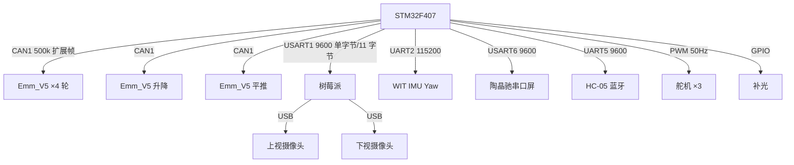

# 系统设计：任务、机械与电气

## 1. 比赛任务（从 main.c 反推）

```
扫二维码 → 拿到 7 位任务码（例如 "123+312"）
  └─ 第 1 圈：从圆盘按颜色顺序抓 3 块 → 在地面色环上按任务码放
  └─ 第 2 圈：再抓 3 块 → 再放
  └─ 码垛区：叠 3 层
  └─ 回启停区，收臂待机
```

场地元素与识别方式：

| 场地元素 | 位置 | 识别 |
| --- | --- | --- |
| 二维码 | 下视摄像头 | `pyzbar`，7 位，连续 3 帧一致才确认 |
| 圆盘上的物块 | 上视摄像头 | `HoughCircles` 找圆 + HSV 判色 |
| 地面色环 | 上视摄像头 | `HoughCircles` + HSV |
| 码垛区 | 上视摄像头 | 同上，另一套像素→毫米系数 |
| 车道边线 | 上视摄像头 | `HoughLinesP` 求角度，`final = mean − 2.0`，限幅 ±9.9° |

**没有循迹、没有避障**：代码完全没用 ADC 做循迹，只有 1 个开关（PC9）+ 1 个按键（PA0）。运动全靠"视觉给坐标 → 里程/角度闭环"。

## 2. 机械结构

| 部件 | 方案 |
| --- | --- |
| 底盘 | 4 轮，X 型全向布置，混控 `s[i] = ±vx + vy ± w` |
| 升降 | 步进丝杆，行程 0–130 mm，80 脉冲/mm |
| 平推 | 步进丝杆，行程 −122…+65 mm，25.465 脉冲/mm |
| 云台 | 单轴旋转（舵机），取块方向 278° |
| 抓手 | 舵机，闭合 6°，张开 50–60° |
| 物块平台 | 舵机，3 个站位 20° / 133° / 250° |
| 补光 | 白光 LED，`TIM3_CH1` PWM 三档（0/250/300） |

**不是多关节机械臂**：只有"云台转 + 升降 + 平推 + 抓手开合"的组合，所以抓取位姿是固定角度表，不是逆运动学。

## 3. 电气结构

```
        12V 电池 ──┬── 电机驱动（Emm_V5 ×6，CAN1 500 kbps）
                   ├── DC-DC ── 5V ── 树莓派 / 摄像头
                   ├── DC-DC ── 3.3V ── STM32F407 / OLED / IMU
                   └── 7V ── 云台舵机
```

- 主控板上只是"2×25P 母座 + 接插件"的**接线底板**（立创「集成板 3.1」），MCU 用核心板/开发板插上去；
- 原理图里没有 DCDC/LDO 芯片 —— 电源是外购模块，具体拓扑与电流能力未在工程中体现；
- 立创工程里共有 7 个 PCB：集成板 3.0（省赛）/ 3.1（国赛）、平推转线板 3.1 / 3.1.1、指示面板省赛 / 3.1、PCB8。

## 4. 通信拓扑



## 5. 方案取舍复盘

| 决策 | 收益 | 代价 |
| --- | --- | --- |
| 用 CAN + 闭环步进而不是直流电机 + 编码器 | 位移可精确给脉冲数、能读回位置、抗堵转 | CAN 帧要自己组，`ExtId=(addr<<8)|packNum` 的分包规则容易错 |
| 位置模式 + 解析延时（不做里程计） | 实现快、调参直观 | 场地摩擦变化会累积误差；每换场地要重标延时 |
| 视觉给的是像素坐标 + 经验系数 | 不用标定内参，上手快 | 摄像头高度/角度一变，4 个系数全要重标 |
| 顺序阻塞流程（不用状态机） | 调试直观、现场好改 | 无法超时重试，视觉丢一帧就卡死 |
| 传统算子（不用深度学习） | 无需数据集、树莓派实时性够 | 光照敏感，要靠补光灯和 HSV 阈值硬调 |

## 6. 两代方案差异（省赛 4.10 vs 国赛 8.6）

| 项 | 省赛 4.10 | 国赛 8.6 |
| --- | --- | --- |
| 固件规模 | `main.c` 约 1 030 行 | `main.c` 987 行 |
| 视觉规模 | 2 794 行（31 函数，含任意形状识别） | 1 910 行（11 个识别函数） |
| 舵机 | 无插值，直接给角度 | TIM2 20 ms 插值平滑 |
| 蓝牙 | 无 `lanya` 分组 | 有 |
| 升降接口 | `shengjiang_control(dir, dis_cm, acc)` | 与平推统一成位置接口，有 `move_all` |
| 色环命令码 | `5` / `6` | `7` / `8` |
| 纠偏 | 无 | 有（`d` 命令） |

**两版必须配套**：固件与视觉脚本命令码不一致，混用会跑错流程。
